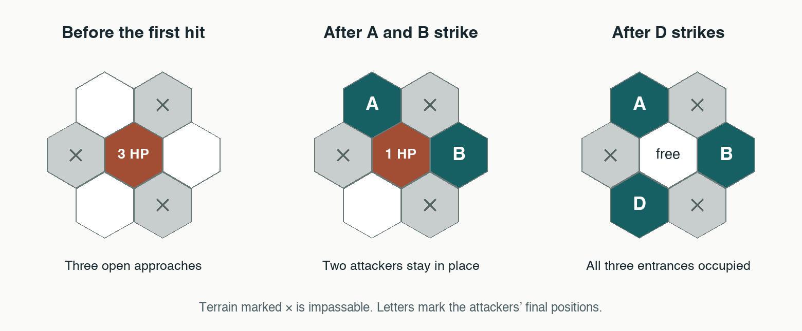

# How one round of Heroes III can encode a hard puzzle

Six stacks deal 4, 4, 5, 5, 6 and 6 damage. Two enemies each have 15 HP. You can kill both by sending a 4, a 5 and a 6 to each. Here is how that small fight leads to a general result, and why a second proof has to worry about the hex a dead stack leaves behind.

## If you had a perfect battle planner

A friend gives you a list of numbers and a target. Can you put the numbers into triples so that every triple hits the target exactly, using each number once? This puzzle is called **3-Partition**. The target and the length of the list can both vary. Researchers already know this puzzle is NP-complete. A proposed grouping is easy to check. Finding a fast method that always gets the right answer would settle the P versus NP question. [Garey and Johnson, Theorem 4.4](https://perso.limos.fr/~palafour/PAPERS/PDF/Garey-Johnson79.pdf)

Imagine you have a program that finds the best legal orders for any battle in the paper's model. Here is how you could use it to answer your friend's question.

1. Make one attacker for each number. Give it that much damage and one attack.
2. For every triple you need, place an enemy with the target number of hit points. The total HP equals the total damage available. All enemies wait, then defend. The winning play strikes before the defence bonus takes effect.
3. Ask whether the program can kill all of them in one round.

**A grouping gives orders.** If your friend has a solution, send each group of three to one enemy. Melee attackers need somewhere to stand. On this six-row board, a clear travel row and three reserved approach hexes per enemy let all three carry out their orders, even after earlier attackers have stopped.

**Orders give a grouping.** If every enemy dies, every point of damage was needed. A skipped attack, a weakened blow or a point of overkill would leave too little damage. Write down who attacked whom. Each enemy must have received exactly the target total. In the hard number puzzles, each number is greater than one quarter of the target and less than half. Two numbers are too small and four are too large. Each group therefore contains exactly three.

Building the battle is quick and needs no knowledge of the answer. That is a **reduction**. A planner that always solved these battles quickly would solve every puzzle in that hard family quickly too. The 15-HP example lets you see the translation in both directions. The result concerns a family of progressively larger boards and armies with prescribed starting hexes.

## Now give every attacker the same damage

Forget the numbers from the first fight. Six identical single-creature stacks, A through F, each deal one damage. There are three enemies with 3 HP each. Walls determine which attackers can approach which enemy.

| Enemy | Attackers with an approach path |
| --- | --- |
| North | A, B, C |
| South | D, E, F |
| Middle | A, B, D |

Can you kill **two** enemies this round? North and South work. Try committing A, B and D to Middle. Middle dies, but C alone can reach North and E and F can reach South. Neither group has three blows. This time the puzzle is choosing two rows that use every letter exactly once. For larger lists of triples this is called **exact cover by triples**. The version whose paths can be drawn without crossings is already NP-complete. [Dyer and Frieze, Lemma 2.2](https://www.math.cmu.edu/~af1p/Texfiles/3DM.pdf)

## Why killing Middle cannot open a shortcut

Think of Middle as the meeting point of three paths. Going around Middle's six neighbours, you encounter a path, a wall, a path, a wall, a path, a wall. Two paths never touch side by side. While Middle is alive, it occupies the only hex that could connect them.

But a dead creature leaves its hex free. Could another attacker use that hex to switch paths and reach an enemy outside its original group? If so, the table would describe only the opening position. A player might win even when the puzzle has no cover.

Zoom in on Middle at the instant it dies. Each hit has to come from the end of a path. On the first hit, A stays on its approach hex and survives the retaliation. On the second, B stays on another. On the third, D kills Middle and stays on the last. **The centre hex is free. To reach it, another stack would first have to step through A, B, D or a wall.** The three attackers have spent their actions and cannot move again this round.



The first enemy to die can only have been attacked from its own three regions. Its death leaves all three entrances occupied. The next enemy therefore still faces exactly its own three attackers. Repeat after each kill. This explains why the original list of triples continues to describe every kill in a winning plan, even as the board changes. A wait postpones an action. Each attacker still gets only one hit.

For the general proof, use three attackers per required kill. A solution to the cover puzzle sends each attacker along a path in its own starting region to one chosen enemy. No other attacker needs that path, and the three attackers meet at three different entrances. In the other direction, a win uses every blow. Each kill takes precisely its three assigned attackers, and none can count towards a second kill. Reading off the dead enemies therefore recovers a cover. The geometric construction lays out any qualifying list of triples on a board of polynomial size. [Full construction and doorway proof](main.md#appendix-d-the-full-proof-of-theorem-3)

You can replay the six-attacker example on a board built by the paper's construction. From the root of this repository, run the command below. It plays both sets of orders and checks the centre hex and all three neighbours used as entrances after each kill.

```sh
python3 scripts/replay_doorway.py
```
